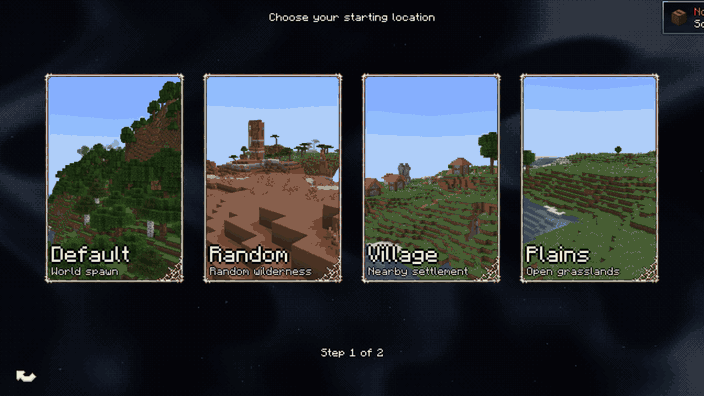
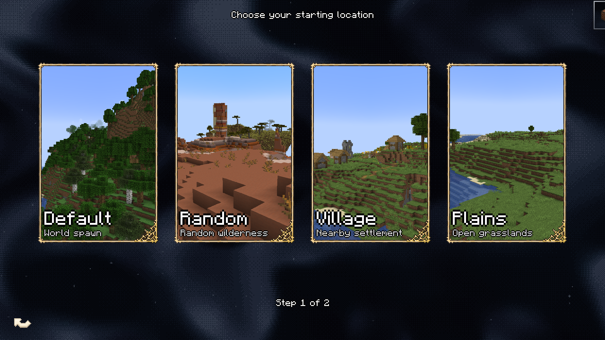
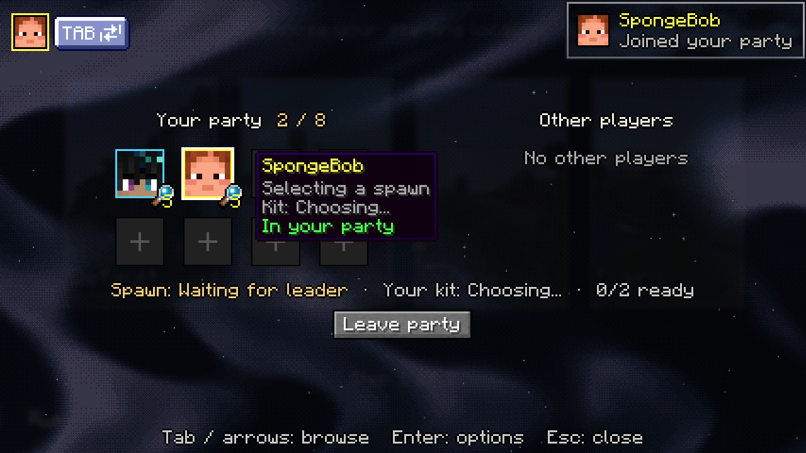
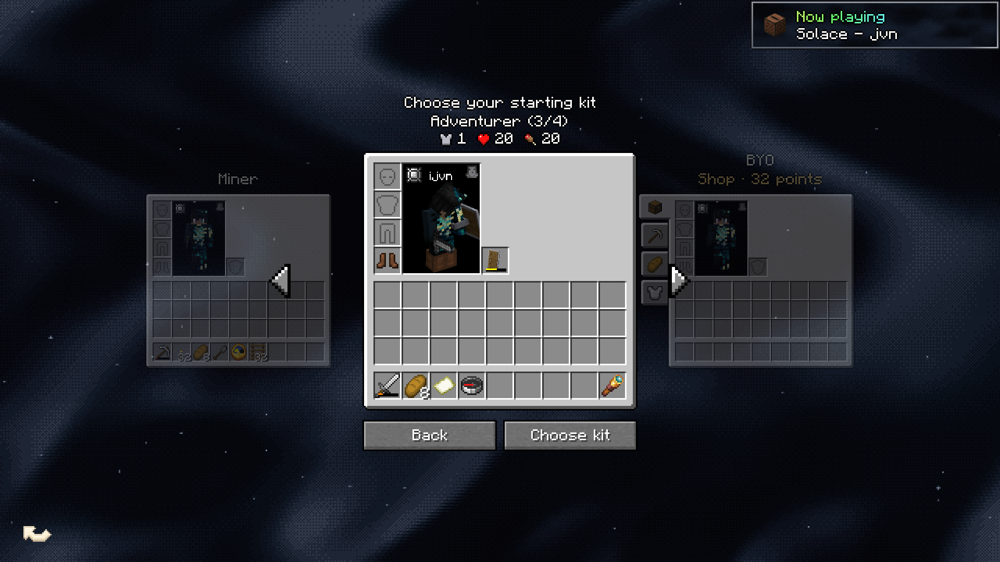
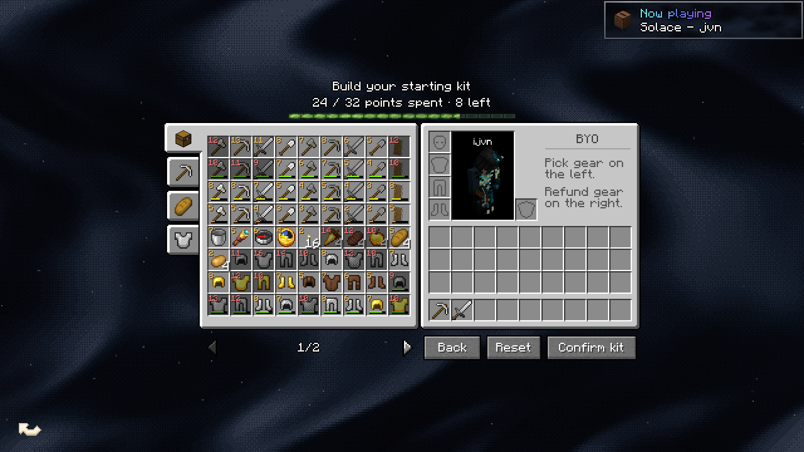
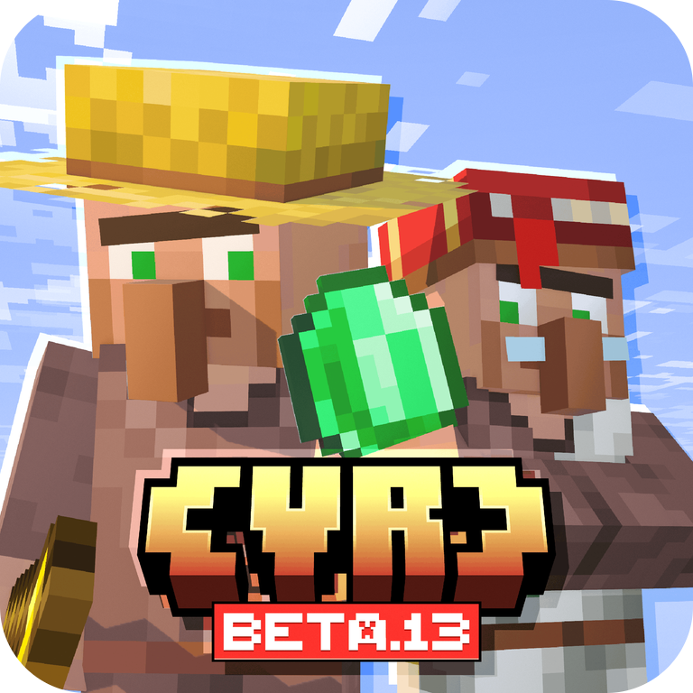
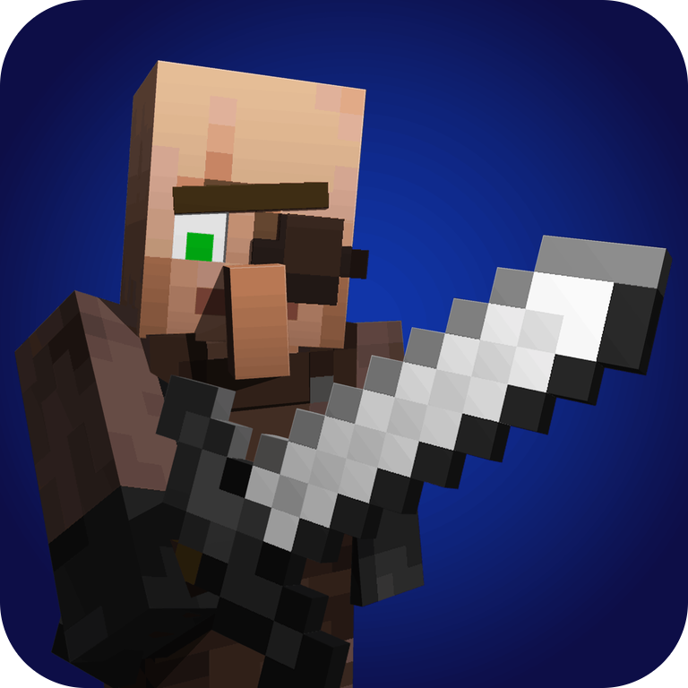
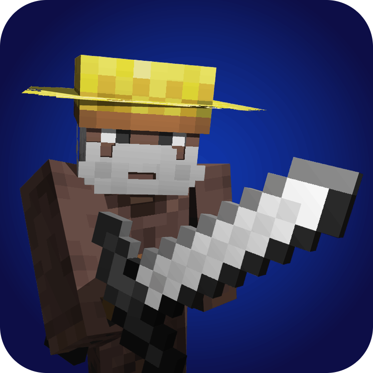
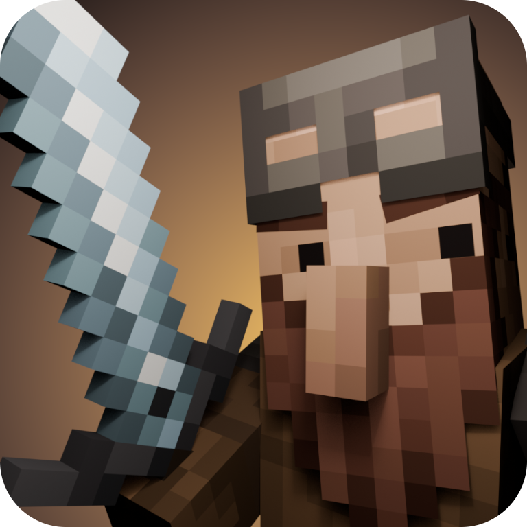

  <h1>Kingdoms: Heritage</h1>

  

  
<em>Where we dropping boys ??</em>

  
Choose where you initially spawn and what you bring with you. Start in a village, spawn in a plains, or take your chances with a random spawn. Go alone or pick a shared starting point with friends to mark the start of your journey!

  

    
    
     
    
    
  

  

    <a href="https://jevendev.github.io/Kingdoms-Heritage/docs.html">Wiki</a> · 
    <a href="https://jevendev.github.io/Kingdoms-Heritage/pack-assembler.html">Pack Assembler</a> · 
    <a href="https://github.com/JevenDev/Kingdoms-Heritage/issues">Report an Issue</a>
  

## 

### Choose where you begin

On your first join, pick world spawn, a village, open plains, or a random spot in the wilderness.

### Start together

Invite friends from the selection screen. Your party shares a starting location, and everyone picks their own gear.

### Choose your kit

Choose an `Adventurer` or `Miner` kit, pick `Naked` to start empty-handed, or spend points on tools, food, and armor in the `BYO` shop. Double-check your inventory and spawn before confirming. A server admin can reopen selection, and you keep your existing inventory on a reset.

### Wake up in your location

After confirming your spawn and kit, you’ll arrive at your chosen location with a first-person wake-up animation by default. By default, each player’s chosen starting location also becomes their respawn point. Servers can disable this with `homelandRespawn`.

## 

### Requirements

- NeoForge 21.1.248 or later
- [ToucanLib](https://modrinth.com/mod/toucan/versions?g=1.21.1&l=neoforge) 1.0.0+

Custom starter kits have support for:

- [Curios](https://modrinth.com/mod/curios/versions?g=1.21.1&l=neoforge) (starter gear in functional and cosmetic slots)
- [Accessories](https://modrinth.com/mod/accessories/versions?g=1.21.1&l=neoforge) (starter gear in functional and cosmetic slots)
- [Cosmetic Armor Reworked](https://www.curseforge.com/minecraft/mc-mods/cosmetic-armor-reworked/files/5610814) (cosmetic armor slots in premade kits)
- [Numismatic Overhaul Reforged Again](https://modrinth.com/mod/numismatic-overhaul-reforged-again/versions?g=1.21.1&l=neoforge) (starting coins deposited into the player's purse)
- [Iron's Spells 'n Spellbooks](https://modrinth.com/mod/irons-spells-n-spellbooks/versions?g=1.21.1&l=neoforge) (starting mana and mana capacity)
- Starting health and hunger, plus modifiers for max health and other vanilla or modded player attributes.

## 

View FAQ

### Will returning players see the selection screen in an existing world?

Players who have already played in that world skip selection by default. New players still choose their start/kit.

### Can I spawn with my friends?

Yes! While everyone is still on the starting-location screen on the same server, open the player list (`Tab` by default), select a friend under `Other players`, and choose `Invite to party`. Once they accept, the leader picks a shared spawn. Everyone chooses a kit and confirms before the party travels.

### Why does it say “Locating...” when choosing a spawn?

The game is searching for a spot that matches your choice, such as a village or a plains biome. If you see `No matching location found within the configured search radius`, pick a different starting location. The target may be farther away than the search radius, configured incorrectly in your custom datapack, or missing from the world’s generation settings.

### Can I use custom starting locations or kits?

Yes, the [Heritage website](https://jevendev.github.io/Kingdoms-Heritage/) has examples and pack tools that should help you along the way. I recommend reading the wiki and examples, but feel free to ask questions in [my Discord server](https://discord.gg/3MaX8VQs5j).

To hide the bundled kits or replace them with your own, see the [guide to overriding bundled options](https://jevendev.github.io/Kingdoms-Heritage/docs.html#/overrides). This mod is intended for modpack authors to create their own specialized kits, so I encourage exploring all the features it has to offer. Feel free to let me know if its missing something that would benefit the mod overall or if anything is broken!

## 

View credits and license

Created with <3 by jvn (me!)

Songs included:
- solace - jvn
- cc - jvn
- excuses - jvn (interpolated the melody of "[excuse](https://c418.bandcamp.com/track/excuse)" by c418!)

The interface sounds are from [Interface Bleeps by Bleeoop](https://bleeoop.itch.io/interface-bleeps) and retain their original sound library license.

Kingdoms: Heritage is [All Rights Reserved](https://github.com/JevenDev/Kingdoms-Heritage/blob/main/LICENSE). See the [attribution file](https://github.com/JevenDev/Kingdoms-Heritage/blob/main/attribution.md) for more details.

Website & AI Assistance

For the website, Generative AI was used to make pretty much most (if not all) of the pack creator website's back end functionality, the mod however was made by myself with AI assistance for polishing features and bug fixing things that I couldn't figure out on my own. No AI was used for the art, logo, music/sfx, or any other assets in the mod/site.

## 

  
  
  

  

